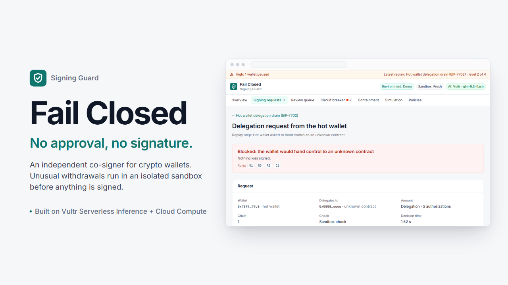
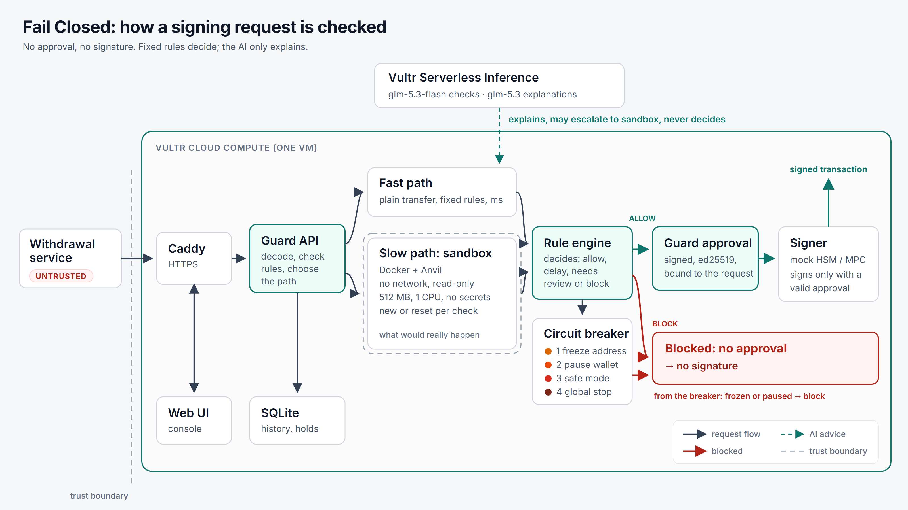

# Fail Closed



**An independent co-signer for crypto wallets.** Before a withdrawal is signed, Fail Closed checks
what the signature will do. Plain payouts to known customers pass in milliseconds. Anything
unusual runs first in an isolated sandbox on a local copy of the chain. Fixed rules decide. The
AI (Vultr Serverless Inference) explains the decision in plain words; it never decides. The
signer signs only with a Guard approval for that exact request: **no approval, no signature.**

Built for the **Vultr Agent Rush** hackathon on lablab.ai, **Challenge 1: Blast Radius Zero**
(3–8 November 2026). Slides: [`docs/slides/fail-closed-vm.pdf`](docs/slides/fail-closed-vm.pdf)
(a laptop version for Plan B: [`fail-closed-laptop.pdf`](docs/slides/fail-closed-laptop.pdf)).

**Live demo:** coming soon (the Vultr VM is not deployed yet).

## Try it in 60 seconds

1. Open the demo and run **Hot wallet delegation drain**. The Guard blocks it. Nothing is signed.
2. Run **Coordinated attack** and watch the risk level rise from 0 (Normal) to 4 (Global stop).
3. Press **Reset demo**. Everything is back to level 0.

Every replay runs on its own isolated state, so you never change another visitor's demo.

## Motivation

Two public incidents inspired this project. Each one shows a class of attack.

| Incident | Attack class | In the demo |
|---|---|---|
| **Binance**, 29 Oct 2026 | **Hot wallet delegation drain (EIP-7702).** A compromised service gets the signer to sign authorizations that hand a hot wallet to an attacker's contract. The contract then empties it. | Replay (d) |
| **Mercado Bitcoin**, 2 Nov 2026 | **Multi-chain hot wallet drain** (the cause is not public). Plain signed transfers send the funds to attacker addresses on many chains, token by token. | Replay (e) |

Fail Closed is designed to reject this class of attack. We do not claim it would have stopped these incidents.

What was reported (sources at the end):

- **Binance.** About $6.3 billion left hot wallets on about 10 blockchains. A DevOps engineer's
  laptop was compromised, and from there the attacker reached a service that submits
  withdrawals. Binance says it found no evidence of a private key leak; the investigation is
  ongoing. The signing system signed what it was asked to sign. On Ethereum, one transaction
  carried 50 EIP-7702 authorizations for 50 consecutive nonces; only one matched, and the wallet
  started running an attacker contract (Blockaid). On the other chains, funds left through plain
  signed transfers.
- **Mercado Bitcoin.** About $38–49M (estimates vary). No EIP-7702: plain signed transfers to
  attacker addresses on at least 10 chains, hundreds of tokens (about 185 on Ethereum alone).
  How the attacker got in has not been made public.
- **Both exchanges** then paused withdrawals for all customers.

The common problem: **the signer trusted where a request came from, and never checked what it
would do.** And when the only defence is a full stop, every honest customer pays too.

The website uses only the neutral attack-class names. The real names stay in this README and in
`docs/`. A test checks the UI source, the built UI and the API text it shows.

## How it works



1. **Judge the effect, not the source.** A request from an "internal" service gets the same checks as any other.
2. **Run unusual requests for real.** A fresh, locked sandbox (local chain, no internet, no
   secrets) shows what really changes. Its starting state (balances, nonces, code) comes from the
   Guard, never from the request.
3. **Fixed rules decide.** The AI explains and gives a risk score. It may ask for a deeper check
   (fast path to sandbox). It can never allow, never downgrade, never turn a BLOCK into an ALLOW.
4. **Fail closed.** If the sandbox breaks, times out or returns nothing, or a rule crashes: BLOCK.

### Two paths

| Path | When | What happens |
|---|---|---|
| **Fast path** | Plain transfer to a known destination, small amount, wallet under its limits | Approved by the rules alone, in milliseconds. The AI is asked only about an amount above 10% of the wallet balance (2 s budget). |
| **Slow path** | Everything else: a destination this wallet never paid, EIP-7702, contract calls, large amounts | Runs in the sandbox, reads the state diff, applies the rules. About 1–3 s. |

- **New destination:** straight to full simulation. The AI is not asked first; it explains afterwards.
- **AI unavailable** (timeout, error, rate limit, invalid answer, no free slot, daily budget
  reached): full simulation, never a fast approval, never a BLOCK just for that.
- **Model calls:** at most 3 at once (`LLM_CONCURRENCY`). Explanations use at most 2, so one slot
  is always free for a check.

### Two kinds of wallets

| Wallet type | Sends to | Rules |
|---|---|---|
| `customer_hot` | Customers' own addresses, unknown in advance. No allowlist. | Behaviour rules: R6, R7, R8, C1 |
| `treasury` | A few known addresses | Strict allowlist: R4, R5 |

R0–R3 and the breaker checks F1–F4 apply to every wallet.

### Verdicts and rules

`ALLOW` → `DELAY` → `NEEDS_HUMAN` → `BLOCK`. The strictest finding wins. DELAY holds a request for
10–15 minutes, then releases it only if a new check finds nothing.

| ID | Rule | Wallets | Verdict |
|---|---|---|---|
| R0 | Sandbox, trace, diff or receipt failed or empty; a rule crashed or missed an input | all | BLOCK |
| R1 | An account gets delegation code (`0xef0100…`) to a contract not on the allowlist | all | BLOCK |
| R2 | More than one authorization, or authorizations for consecutive nonces | all | BLOCK |
| R3 | A wallet loses more than 25% of its balance to one address. Without sandbox evidence | all | NEEDS_HUMAN |
| R3 | The same, with sandbox evidence (an undeclared outflow, or funds moved by the delegation probe) | all | BLOCK |
| R4 | Amount above the limit | treasury | NEEDS_HUMAN |
| R5 | Destination not on the allowlist | treasury | NEEDS_HUMAN (BLOCK if also above the limit) |
| R6 | Wallet outflow in a time window above the limit | customer_hot | BLOCK |
| R7 | The same destination paid from ≥ 3 chains in 6 h | customer_hot | DELAY; from ≥ 5 chains: freeze the address |
| R8 | ≥ 10 different assets to one address in 30 min | customer_hot | Freeze the address |
| C1 | Not a native transfer or an ERC-20 `transfer` to a known token | customer_hot | NEEDS_HUMAN |

Thresholds are starting values in `.env`, not tuned on real traffic.

### Circuit breaker and risk level

Each level stops as little as possible and stays on until a person resets it. Every reset is logged.

| Level | Risk colour | What it stops | Trigger |
|---|---|---|---|
| 0 | Normal (neutral) | nothing | |
| 1 | Elevated (amber) | one address is frozen | R7 (≥ 5 chains) or R8 (≥ 10 assets) |
| 2 | High (orange) | one wallet is paused | R1, R2, or R3 with sandbox evidence |
| 3 | Critical (red) | one chain is in safe mode: every request there waits for a person | ≥ 2 paused wallets or ≥ 3 evidence blocks on that chain within 60 min |
| 4 | Global stop (deep red) | every approval | only with ≥ 2 independent signals |

The web UI shows the level on every page (a strip with the level name, an icon and one sentence),
on the Overview, and next to "Circuit breaker". Level 4 shows a deep red banner. Lifting it needs
the admin token. Colours always come with text and an icon, with WCAG AA contrast.

### Approval and signer

1. The Guard has its own ed25519 key and no wallet keys. The key is created on first start,
   outside the repository, owner-only, and never enters a sandbox.
2. Every request is hashed in one canonical form. Change any field and the hash changes.
3. Only an ALLOW gets an approval: the Guard signs `{request_hash, verdict, expiry, approval_id}`.
4. The signer knows only the Guard's public key. It signs only with a valid, unexpired, unused
   approval for exactly this request. Anything else is refused with a reason.

## Where Fail Closed fits

Fail Closed is a prototype, not a product. Parts of this space already exist:

- **Threat intelligence and pre-signing screening** exist as products, for example
  [Blockaid Cosigner](https://blockaid.io/cosigner) and
  [Hypernative Transaction Guard](https://www.hypernative.io/product/transaction-guard).
- **Signer hooks** where a customer adds its own last check before signing exist too:
  [DFNS Validation Gate](https://dfns.co/article/introducing-validation-gate),
  [Fireblocks API Co-signer Callback Handler](https://developers.fireblocks.com/reference/api-cosigner-setup-callback-handler) and
  [Fordefi Custom API Approver](https://docs.fordefi.com/developers/transaction-types/build-custom-api-approver).
  They give the enforcement point; the customer writes the decision logic.
- **Fail Closed is a prototype of that decision logic:** fixed rules decide, unusual requests run
  in an isolated sandbox, every failure fails closed, a scoped circuit breaker limits the damage,
  and the AI only explains.

We describe these products only from the public pages linked above. Where a feature is not
mentioned, it is not publicly documented in the sources we read; we make no claim beyond that.

| Built in this prototype | Next (not built) |
|---|---|
| Fixed rules decide; the AI explains and may ask for a deeper check | Plug into one real signer hook |
| Isolated sandbox: state diff and a delegation probe | Check that every signature matches an approved withdrawal in the exchange ledger, from a separate trust domain |
| Fails closed on every error, timeout or empty result | Deny unknown operation types on withdrawal wallets (for example EIP-7702 delegation) |
| Scoped circuit breaker (address, wallet, chain, global), every reset logged | Rules for deposit-address sweeps |
| A Guard approval bound to the request hash; the signer checks it | A pre-approved path to revoke a bad EIP-7702 delegation that the breaker never blocks |

## Vultr services used

| Service | What it does here |
|---|---|
| **Vultr Serverless Inference** | `glm-5.3-flash` (reasoning effort minimal, JSON mode): the fast-path AI check, only for large amounts to known customers, 2 s budget. `glm-5.3`: the explanation card after a slow-path check (20 s timeout, falls back to `glm-5.3-flash`). The AI explains and may escalate to the sandbox; it never decides. Capped at 3 calls at once and $1 a day in the public demo. |
| **Vultr Cloud Compute** | One VM runs everything else: Caddy (HTTPS), the Guard API on the host as a limited user, the sandboxes (Docker + Anvil, rootless Docker), SQLite history and the web UI. Plan: `docs/deploy.md`. |

Why `glm-5.3-flash` for checks: in our comparison it answered all 24 checks within 2 s; the
other setups answered 5–12 of 24 in time (table below).

## Results

All numbers below are our own measurements. Each says where and how it was measured. None are
from the Vultr VM yet.

**500 normal withdrawals + 1 hidden attack.** Laptop (Windows 11, 16 CPUs, Docker Desktop 7.4 GiB),
mock AI (800 ms per call, escalates 5% of plain transfers), 8 requests at a time, 2026-11-06,
`backend/cli.py loadtest`. Data: `docs/results/loadtest-20261106-111314.md`. About 90% of payouts
go to customers the wallet paid before, about 10% to new destinations, about 2% are large payouts.

| Setup | Attack stopped | Normal refused | Fast path p50 / p95 / p99 | Slow path p50 / p95 / p99 | Throughput | Sandboxes |
|---|---|---|---|---|---|---|
| fresh sandbox, AI escalation on | **1/1** | **0** | 2 / 7 / 1049 ms (n=445) | 2408 / 2822 / 4007 ms (n=56) | 26.9 req/s | 56 |
| fresh sandbox, AI escalation off | **1/1** | **0** | 7 / 12 / 14 ms (n=500) | 1732 ms (attack only) | 237.8 req/s | 1 |
| warm sandbox, AI escalation on | **1/1** | **0** | 3 / 12 / 919 ms (n=445) | 1251 / 1524 / 2233 ms (n=56) | 48.9 req/s | 4 |
| warm sandbox, AI escalation off | **1/1** | **0** | 6 / 10 / 12 ms (n=500) | 1024 ms (attack only) | 376.0 req/s | 4 |

- The attack (3 EIP-7702 authorizations to a sweeper) was blocked in every setup. No normal customer was refused.
- With escalation on, the 54 new destinations were simulated and the 12 large amounts asked the
  AI. The fast-path p99 of about 1 s is those 12 mock AI calls.
- The warm pool (containers kept ready and reset to a snapshot after each check) is about 1.2 s
  faster per sandbox check.

**Short check with the real model.** 49 normal + 1 attack, real Vultr `glm-5.3-flash` + `glm-5.3`,
warm pool, laptop, 2026-11-06. Data: `docs/results/live/loadtest-20261106-111340.md`.
Attack stopped, 0 normal refused, 0 rate limits (429), 11 model calls, $0.015. The 5 new
destinations were simulated. The 3 large amounts asked the AI; none answered within 2 s, so all
3 took a full simulation (slower, never wrongly approved).

**Which model** (laptop, real Vultr models, 2026-11-04, `backend/llm_eval.py`, 24 calls each,
data in `docs/results/llm_eval.md`):

| Model (reasoning effort) | p50 | p95 | Under 2 s | Valid JSON | Cost |
|---|---|---|---|---|---|
| **`glm-5.3-flash` (minimal)** | **933 ms** | **1148 ms** | **24/24** | **24/24** | $0.003 |
| `glm-5.3` (minimal) | 4243 ms | 30012 ms | 5/24 | 22/24 | $0.021 |
| `qwen3.8-flash-next` (minimal) | 2026 ms | 3025 ms | 12/24 | 24/24 | $0.005 |
| `glm-5.3-flash` (provider default) | 2265 ms | 4037 ms | 10/24 | 19/24 | $0.009 |

Model latency changes from day to day: on 2026-11-05 six sequential `glm-5.3-flash` calls took
2.0–7.2 s (laptop, a separate latency probe; not saved as a file).

**Red team: 7/7 contained.** Laptop, Docker Desktop, `backend/cli.py redteam`, 2026-11-06, file
`docs/results/redteam-20261106.txt` (first run 2026-11-03); the same 7 checks pass in every browser
test run. Details in the next section.

## Security and containment

### Sandbox

Every slow-path check runs in a container that is new, or reset to a clean snapshot, per check:
no network, read-only file system, temporary files in memory only, 512 MB with no swap, 1 CPU,
128 processes, a hard timeout, all Linux capabilities dropped, no privilege escalation, a
non-root user, and **no keys or secrets inside, ever**.

### Red team

`backend/cli.py redteam` runs hostile code in a sandbox with exactly the same limits as a normal
check. Each result is judged by what actually happened (cgroup counters, `/proc`, output), not by
exit codes. Measured on the laptop with Docker Desktop, 2026-11-03:

| Payload | What it tries | What stops it | Result |
|---|---|---|---|
| network | 1.1.1.1:443, the Docker host, `host.docker.internal`, cloud metadata, DNS | no network | 6/6 blocked |
| secrets | environment, `/proc/1/environ`, `.env`, `docker.sock`, keys | no env, no mounts, no secrets in the image | nothing found |
| write | `/`, `/etc`, `/usr`, `/sandbox`, `/home`; run a binary from `/tmp` | read-only, `/tmp` noexec | 5/5 read-only; exec blocked |
| fork bomb | `f() { f \| f & }; f` | 128 processes | peak 128, 1766 forks refused |
| memory bomb | allocate 2000 MiB | 512 MB, no swap | killed (out of memory) |
| CPU spin | an endless loop | 1 CPU + timeout | stopped, container removed |
| privilege | `mount`, `chown`, setuid, raw socket | no capabilities, non-root | all blocked |

During the fork and memory bombs the API's `/health` answered 9/9 and 2/2 times (max 49.5 ms).

### Fail closed

Each of these ends in **BLOCK, no approval, no signature** (tested end to end): the sandbox is
killed mid-check; the trace is empty, broken or missing; the receipt is missing; the sandbox
times out; Docker is unreachable; the starting state does not read back correctly; a rule
crashes. Too many sandboxes at once: **503 "Guard busy"**, nothing signed. If the AI is down, the
rules still decide.

### Public demo mode

`PUBLIC_DEMO=true` (on the VM):

- **Visitors** run replays, the simulation and the review-queue demo, and read policies and
  containment. "Reset demo" puts their own demo back to level 0. It also resets on its own after
  10 minutes without activity.
- **Admin token only:** raw `/check` and `/withdraw`, lifting a real breaker level, the Guard's own queue.
- **Per-IP limits:** 10 replays a minute and 2 simulations per 10 minutes, with a plain message when hit.
- **Daily model budget:** $1. When reached: "Demo budget reached: AI explanations paused until
  tomorrow". Decisions keep working; the AI is never replaced by the mock.

The page holds no secrets. Text from requests, tokens or the AI is always shown as plain text.

## Honest limits

- If an attacker also takes over Fail Closed or its approval key, the protection is gone. It must run on separate infrastructure with separate access.
- It does not stop the first break-in (for example a stolen laptop). It stops that break-in from getting a signature.
- Small transfers to known destinations pass on the fast path. Rate and outflow limits reduce the damage but do not remove it.
- A hackathon prototype: a local test chain with fake funds, not mainnet. The mock signer signs the request hash to show the flow; it does not produce a broadcastable transaction.
- EIP-7702 is simulated by its effect (delegation code + nonce bump), because the Guard is asked before a signature exists. A test shows it gives the same diff as a real type-4 transaction for test accounts.
- The AI output is untrusted too: plain, length-limited text, made after the verdict, never read by the rules. Request data is sent to the model inside one marked block it is told never to obey.
- All measured numbers come from a laptop, not yet from the Vultr VM.
- Model latency varies a lot (933 ms median one day, about 4.5 s the next, laptop). A late AI check means a full simulation: safe, but slower.
- On the VM, sandboxes run on the API user's rootless Docker (so Docker access is not root). If the red team is not 7/7 there, the allowed fallback is the normal Docker daemon with the API user in the `docker` group, which is root-equivalent; if the demo runs that way, this line will say so. Plan B (a laptop with a tunnel) uses Docker Desktop.
- Public demo limits and the daily budget live in one API process. Up to 3 model calls already running may finish after the budget is reached.
- The Guard key file permission check runs on Linux and macOS, not on Windows.

## Run it locally

Needs Docker (Docker Desktop on Windows), Python 3.12+ and Node 20+.

```sh
cp .env.example .env            # optional: VULTR_INFERENCE_API_KEY (without it the AI is a labelled mock)
sandbox/build.sh                # the sandbox image (Windows: .\sandbox\build.ps1)
cd backend && python -m venv .venv && .venv/bin/pip install -e '.[dev]' && cd ..
cd frontend && npm install && npm run build && cd ..
cd backend && .venv/bin/python -m uvicorn app.api:app --host 127.0.0.1 --port 8000
# open http://127.0.0.1:8000   (Windows: .venv\Scripts\python -m uvicorn ...)
```

Without a key, every AI result is marked **[MOCK]**. With a key, a failure never falls back to the mock.

From the command line:

```sh
scenarios/run.sh                        # all replays (a-g) in one table (Windows: .\scenarios\run.ps1)
scenarios/run.sh d_delegation_drain     # one replay with the full report
backend/.venv/bin/python backend/cli.py loadtest   # 500 + 1 load test (needs 2 GB free RAM)
backend/.venv/bin/python backend/cli.py redteam    # containment check
```

| Replay | Expected |
|---|---|
| (a) Everyday customer withdrawal | a new customer: full simulation, approved; the same customer again: approved on the fast path |
| (b) Treasury payout above the limit to its own cold storage | NEEDS_HUMAN (R4) |
| (c) Treasury payout above the limit to an unknown address | BLOCK (R5) |
| (d) Hot wallet delegation drain (EIP-7702) | BLOCK (R1, R2, R3 from the probe), wallet paused |
| (e) Multi-chain drain after key theft | ALLOW, then DELAY (R7), then BLOCK and the address is frozen; other customers still paid |
| (f) Honest large customer withdrawal | NEEDS_HUMAN (R3 without evidence), nobody paused |
| (g) Coordinated attack on several wallets and chains | breaker level 1 → 2 → 3 → 4; an operator lifts it with the admin token |

The API (`backend/app/api.py`): `POST /check` (dry run, never an approval), `POST /withdraw`
(Guard → approval → mock signer), `GET /stream` (live events; the page falls back to polling
`GET /events` when the stream does not get through, or always with `LIVE_UPDATES=poll`), `GET /scenarios` and
`POST /scenarios/{name}/run`, `GET /policies`, `GET /breaker`, admin resets with `X-Admin-Token`,
`POST /demo/reset`, `POST /loadtest/run`, `POST /redteam/run`. Deploying to Vultr: `docs/deploy.md`.

## Tests

| Suite | Count | Where |
|---|---|---|
| Unit and API tests, Python 3.12 | 575 passed, 28 skipped (the Docker ones) | `python:3.12-slim` container, 2026-11-06 |
| Real sandbox + browser tests | 28 passed, 0 containers left | laptop, Docker Desktop, Chromium (Playwright), 2026-11-06 |

```sh
# Python 3.12, no Docker needed inside
docker run --rm -v "$PWD:/src:ro" python:3.12-slim sh -c \
  "mkdir /w && cd /src && tar --exclude=./backend/.venv -cf - backend scenarios | tar -xf - -C /w \
   && cd /w/backend && pip install -q -e '.[dev]' && pytest -q"

# real sandboxes and the browser (Docker, the built UI, python -m playwright install chromium)
cd backend && .venv/bin/python -m pytest -m docker
```

`FC_SCREENSHOTS=1` refreshes `docs/screenshots/`; `FC_LIVE_LLM=1` uses the real model from `.env`.
The cover, diagram and slides are rebuilt with `docs/brand/export.py` and `docs/slides/export.py`.

## License

MIT, see [LICENSE](LICENSE). The fonts in `docs/brand/fonts` are under the SIL Open Font License
(see the files there).

---

More: [design log](docs/design-log.md) · [deploy plan](docs/deploy.md) · [load-test data](docs/results/)

## Sources

Incidents:
- TRM Labs, [North Korea steals USD 6.36 billion from Binance](https://www.trmlabs.com/resources/blog/north-korea-steals-usd-6-36-billion-from-binance-in-the-largest-hack-in-history)
- BleepingComputer, [Binance links theft to compromised DevOps laptop](https://bleepingcomputer.com/news/security/binance-links-63-billion-crypto-theft-to-compromised-devops-laptop)
- DEV Community, [50 signatures and a 37-minute race](https://dev.to/thevenice/how-a-53b-binance-hot-wallet-hack-worked-eip-7702-50-signatures-and-a-37-minute-race-2lea)
- Blockaid, [analysis of the Binance hack and the EIP-7702 authorizations](https://blockaid.io/blog/binance-55b-hack-using-advanced-ai-models-blockaid-detects-the-biggest-theft-in-crypto-history)
- Decrypt, [Mercado Bitcoin halts withdrawals after hack](https://decrypt.co/382341/mercado-bitcoin-halts-withdrawals-40-million-hack)

Products in "Where Fail Closed fits":
- DFNS, [Introducing Validation Gate](https://dfns.co/article/introducing-validation-gate)
- Fireblocks, [API Co-signer callback handler](https://developers.fireblocks.com/reference/api-cosigner-setup-callback-handler)
- Fordefi, [Build a custom API approver](https://docs.fordefi.com/developers/transaction-types/build-custom-api-approver)
- Blockaid, [Cosigner](https://blockaid.io/cosigner)
- Hypernative, [Transaction Guard](https://www.hypernative.io/product/transaction-guard)

Author: Konstantinos Diamantidis · Computer Science, Democritus University of Thrace · [github.com/KDiamantidis](https://github.com/KDiamantidis)
